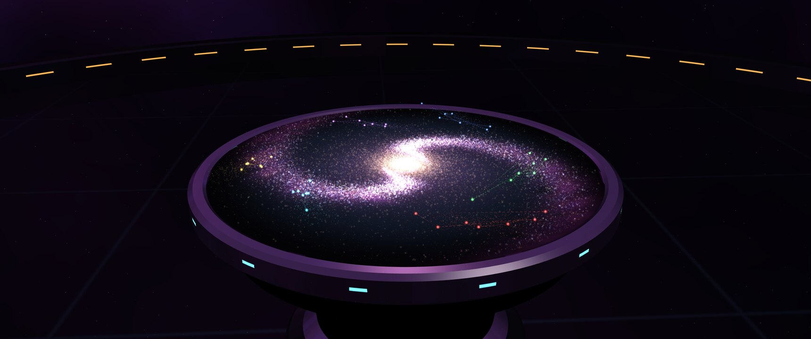

# Orion 1993 screensaver

The screensaver for the [Orion 1993](https://github.com/dennisp80/omarchy-orion-1993-theme) theme for
[Omarchy](https://omarchy.org): gold pixels assemble the ORION emblem, it glows, a shockwave rolls out
and the emblem explodes into a jump to lightspeed. Then ~310 000 glowing carriers fly back in from every
direction and build a 3D strategy table, and the camera takes off and circles it: a chrome table with
cyan lights, a mirror floor, open space all around, and on the table a living galaxy of ~150 000 stars
with six empires and their trade routes. The inner galaxy turns faster than the outer (differential
rotation), so the spiral arms slowly wind up as you watch.



**Try it in your browser first:** <https://dennisp80.github.io/omarchy-orion-1993-screensaver/page/?test>
(press F11 for fullscreen; Esc stops it). It is just a web page, so it runs in any desktop
Chrome, Chromium, Brave or Firefox with a GPU.

Everything is generated, there are no 3D models or images: the table is a lathe profile of ~14 points,
the galaxy, gas, dust and space are noise and math, and the whole screensaver is about 50 kB.

## Install

Requires Omarchy 4, and Chromium, Chrome or Brave for the WebGL version (without one it falls back to
Omarchy's text effects). It goes with the theme, so install that first:

```bash
omarchy theme install https://github.com/dennisp80/omarchy-orion-1993-theme
git clone https://github.com/dennisp80/omarchy-orion-1993-screensaver ~/.local/src/omarchy-orion-1993-screensaver
~/.local/src/omarchy-orion-1993-screensaver/install.sh
```

The script explains what it does before it does anything. In short, it adds:

- a wrapper in `~/.local/share/orion-1993/bin/` that is first on `PATH`, and a copy of the screensaver
  page in `~/.local/share/orion-1993/page/`.
  It only takes over while the orion-1993 theme is active; with any other theme, Omarchy's own screensaver runs.
- the `PATH` entry, in two places: `~/.config/uwsm/env` for the session, and a clearly marked block
  at the end of `~/.config/hypr/hyprland.lua`. Omarchy 4's Hyprland defaults put `/usr/share/omarchy/bin`
  first for everything Hyprland starts, so without the block Omarchy's own screensaver would run.
- a theme-set hook that switches the screensaver text to the ORION emblem for this theme.

The browser runs without network access: it starts in its own network namespace (`unshare -cn`, no root
needed; this needs unprivileged user namespaces, the default on Arch), so the page can't reach the internet, your LAN or localhost, not even over WebRTC. The page
loads nothing from the network anyway. The wrapper and the page are copies, so pulling a new version of
this repository never changes what runs; run `install.sh` again to pick it up.

The script reloads Hyprland, so it works right away. Try it with `omarchy-launch-screensaver force`.
If you still see Omarchy's text effects, log out and back in once.
**Esc** (or any key, or moving the mouse) ends it. Undo everything with `uninstall.sh`.

### Installed it from the theme before November 2026?

The screensaver used to ship inside the theme (`screensaver/install.sh`). Omarchy's theme list doesn't
allow code in themes, so it moved here. After the theme updates, the old install quietly falls back to
Omarchy's text effects. Run `install.sh` from this repository once: it recognises the old install and
upgrades it in place (no duplicate `PATH` entries), and `uninstall.sh` here removes either version.

## How it works

The screensaver is a web page shown in a kiosk window of Chromium, Chrome or Brave:

| File | What |
|---|---|
| `page/index.html` | The build: ~310 k carriers that each paste a sharp 4×4 tile on landing, and a half-resolution glow layer that only fades (comet tails and bloom for free). The target picture is the first frame of the 3D scene, so the hand-over is seamless. |
| `page/table3d.js` | The 3D scene in WebGL2: lathed table and railing, mirror floor, noise space, ~150 k stars as points with differential rotation, gas and dust in the table top, empires with dashed trade routes, the camera orbit. 15 kB. |
| `page/emblem.js` | The ORION emblem's pixels. |
| `page/cpu.html` + `data.js` | Used automatically when there is no GPU (no WebGL2, or SwiftShader/llvmpipe): the earlier version that builds the background picture. About 1.6 cores in Chromium's pure software path. |
| `page/orion.txt` | The ORION emblem as text, for Omarchy's text-effect screensaver. |
| `bin/omarchy-screensaver` | The wrapper that stands in front of Omarchy's own screensaver. |

On a 3440×1440 screen at 60 fps the 3D version uses about a fifth of a CPU core and ~40 % of a mid-range GPU.
Without a browser the screensaver falls back to Omarchy's text effects, tinted in the theme's colors.

## Credits

- The ORION emblem was generated with an AI image model (OpenAI) and then remapped to the palette.
- Inspired by, and not affiliated with, the classic space strategy games of 1993.

## License

[MIT](LICENSE)
